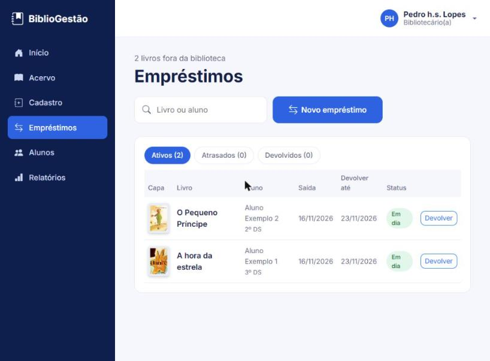
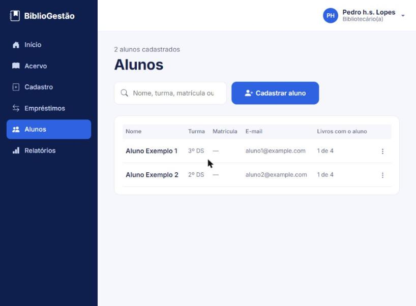
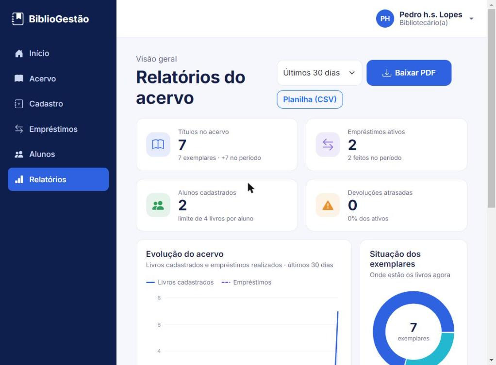

# Gestão de Acervo Bibliotecário

Sistema web para uma biblioteca escolar controlar o **acervo**, os **leitores (alunos)** e os **empréstimos**, com leitura de código de barras, relatórios em PDF e avisos por e-mail.

## Telas

## O que o sistema faz

- **Acervo:** cadastro e consulta de livros.
- **Cadastro por escaneamento:** lê o código de barras (ISBN) pela câmera e busca título, autor e capa no Google Books.
- **Alunos (leitores):** cadastro de quem pega livros emprestados.
- **Empréstimos:** registra retirada, data prevista e devolução.
- **Relatórios:** gráficos e exportação em PDF.
- **E-mails automáticos:** avisos de empréstimo, devolução e atraso, enviados por uma função de servidor.
- **Login:** só bibliotecários autenticados acessam o sistema.

## Tecnologias

React 19 · TypeScript · Vite · React Bootstrap · React Router · Supabase (banco de dados PostgreSQL e autenticação) · Recharts · jsPDF · html5-qrcode · Nodemailer · Vercel (hospedagem e função serverless)

## Como rodar

1. Instale as dependências: `npm install`
2. Crie o projeto no [Supabase](https://supabase.com) e execute o arquivo `supabase/schema.sql` no editor SQL. Ele cria as tabelas (`perfis`, `livros`, `leitores`, `emprestimos`) e ativa a segurança por linha (RLS).
3. Copie `.env.example` para `.env.local` e preencha as variáveis.
4. Rode: `npm run dev`

Para publicar, conecte o repositório à Vercel e cadastre as mesmas variáveis de ambiente no painel dela.

## Estrutura

- `src/pages`: telas (Acervo, Empréstimos, Alunos, Escanear, Relatórios, Login)
- `src/components`: componentes reutilizáveis (modais, layout, rota protegida)
- `src/context`: autenticação e estado do acervo
- `src/utils`: ISBN, Google Books, datas, relatórios e PDF
- `api/enviar-email.ts`: função de servidor que envia os e-mails (a senha do e-mail fica só no servidor)
- `supabase/schema.sql`: tabelas e regras de acesso

## Segurança

As chaves ficam em `.env.local` (fora do Git). A senha do Gmail é usada apenas na função de servidor, nunca no navegador.

## Sobre o desenvolvimento

Projeto em grupo, desenvolvido com apoio de IA (Claude) na escrita do código.
